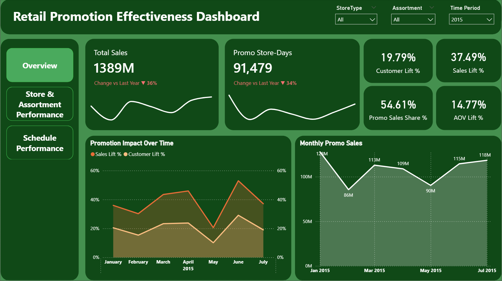

# 🛍️Retail Promotion Effectiveness Analysis

## 🏢 Project Overview
Rossmann operates a network of retail stores, where promotional activities play an important role in driving sales and attracting customers. However, promotions may not deliver the same results across stores and time periods.

This project analyzes sales data from 1,115 Rossmann stores to evaluate promotion effectiveness and identify opportunities to improve promotional decisions. The analysis focuses on four key questions:
- Do promotions improve sales performance and customer traffic?
- How does promotional effectiveness vary across different months and calendar events?
- Which store types demonstrate stronger promotional performance?
- How does promotional effectiveness differ across assortment types?

## 🗂️ Dataset 
- **Source:** https://www.kaggle.com/datasets/pratyushakar/rossmann-store-sales/data
- **Analysis Period:** January 2013 – July 2015
- **Analysis Scope:** July 2015
- **Tables:**
  + **Dim_Store:** Store, StoreType, Assortment, CompetitionDistance, CompetitionOpenSinceMonth, CompetitionOpenSinceYear, Promo2, Promo2SinceWeek, Promo2SinceYear, PromoInterval.
  + **Dim_Date:** Created in Power BI using DAX to support time-based analysis.
  + **Fact_Sales:** Customers, Date, DayOfWeek, Sales, Open, Promo, SchoolHoliday, StateHoliday, Store.
- The Fact_Sales table is linked to Dim_Store through the Store column and to Dim_Date through the Date column, both in one-to-many relationships.

## 🛠️ Tools & Skills
- **SQL Server:** Data quality checks (data types, missing values, duplicate records, business rules).
- **Power Query:** Data transformation and categorical value standardization.
- **Power BI:** Exploratory data analysis, data modeling, DAX measures, Dim_Date table creation, and interactive dashboard development.

## 📈 Dashboard Preview

[View Full Dashboard](https://github.com/buithaotrang9/social-media-benchmark-analysis/blob/main/dashboard/Social%20Media%20Dashboard.pbix)



## 🔍 Key Insights
**1. Monthly Promotion Effectiveness & Seasonality**

- **January** generated the highest total promotional sales reaching **123M**, largely supported by strong baseline seasonal demand.
- **June** achieved the strongest promotional efficiency with **52.71% Sales Lift** and **29.12% Customer Lift**, indicating a highly effective promotional campaign.

**2. Performance Across Store Types**

- **Store Type A** is the primary revenue driver, leading in both total promotional sales **(409M)** and promotional uplift **(Sales Lift 41.58%, Customer Lift 24.04%)**.
- **Store Type B** showed the lowest performance with minimal promo sales **(17M)** and the lowest **Sales Lift of 17.23%**, requiring a strategic review before expanding marketing budgets there.

**3. Impact by Assortment Categories**

- **Basic** assortment delivered the strongest performance with a **Sales Lift of 40.90%** and **Customer Lift of 22.74%**.
- **Extended** assortment closely followed with a **35.29% Sales Lift**. Meanwhile, Extra assortment yielded a much lower response **(7.23% Sales Lift)**, showing lower price sensitivity under current promotions.

**4. Temporal Patterns**

- **State Holidays:** Major holidays like Easter Holiday generated the most significant surge, reaching up to **67.2% Sales Lift**, significantly outperforming normal days **(37.5%)** and other public holidays **(8.6%)**.
- **Day of Week:** Promotional volume concentrated heavily at the beginning of the week (**Monday** peaked at **18.9K Promo Store-Days** and yielded the highest **Sales Lift of 59.96%**), gradually declining toward the weekend (dropping to **21.52% on Friday**).

## 💡 Recommendations
**1. Campaign Timing Optimization** 
- Reallocate marketing budget and large promotional campaigns toward high-lift months (such as June and April) to maximize conversion efficiency, rather than solely relying on months with naturally high baseline sales (like January).
- Capitalize on major holidays (especially Easter Holiday and long weekends) as they deliver exceptional promotional uplift.
- Capitalize on the "Monday Effect": Concentrate flash sales and promotional vouchers on Mondays to capture peak customer purchasing intent instead of distributing budget evenly throughout the week.

**2. Refine Promotion Allocation Across Store Types:** 
- Prioritize marketing resources and campaign testing in **Store Type A**.
- For **Store Type B**, evaluate localized customer behavior or alternative engagement strategies (such as bundling or gift-with-purchase) given its low promotional responsiveness.

**3. Tailor Promotional Strategies to Assortment Types:** 
- Focus flash sales and deep discounts primarily on **Basic** and **Extended** assortments to effectively stimulate basket size and customer traffic.
- Review discount conditions for the Extra assortment to avoid margin erosion without achieving proportional sales lift.

## ⚠️ Limitations

The dataset does not include promotion costs, operating expenses, or profit margins. Therefore, the analysis focuses on sales and customer performance rather than profitability or ROI.

The dataset provides daily store-level data but does not contain transaction-level or product-level details, limiting deeper analysis of purchasing behavior and product-specific promotional performance.

The dataset categorizes stores into four types (A, B, C, and D) without providing detailed descriptions of their business characteristics. Therefore, the analysis can compare promotional performance across store types but cannot explain the underlying reasons for the differences.

## 📁 Project Structure
```text
retail-promotion-effectiveness-analysis/
│
├── dashboard/
│   └── Retail Promotion Effectiveness.pbix
│
├── dataset/
│   ├── store.csv
│   └── train.zip
│
├── screenshots/
│   ├── overview.png
│   ├── schedule_performance.png
│   └── store_&_assortment_performance.png
│
├── sql/
│   └── Data Quality Check.sql
│
└── README.md
